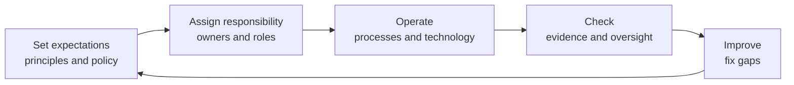

## 1. What is identity governance?

Identity governance is the set of principles, policies, responsibilities and oversight that guide how an organisation manages identities and the information associated with them.

It helps an organisation answer three fundamental questions:

- **What identities exist?** Does the organisation know which people, applications, services and other entities have identities in its environment?
- **Who is responsible for them?** Is there someone accountable for the accuracy, purpose and appropriate management of each identity?
- **Can the organisation demonstrate control?** Can it show that identity information is managed appropriately and that responsibilities are being fulfilled?

Identity governance is not a technology on its own. It establishes the expectations and accountability that identity management processes and technologies need to support.

## 2. Why does identity governance matter?

Identity systems are often used as the foundation for access decisions. If the underlying identity information is inaccurate, incomplete or poorly managed, those decisions may also be unreliable.

Consider a few examples:

- An employee's identity record contains an outdated department, which may affect how their access is determined.
- A service account exists without anyone knowing who owns it or why it is needed.
- Two different systems contain conflicting information about the same contractor.
- An organisation collects personal information that its applications do not actually need.

These are not simply technical problems. They raise questions about ownership, accountability, information quality and risk.

Good identity governance helps an organisation establish who is responsible for identity information, what information should be maintained and how identity-related risks should be managed.

## 3. How does it work?

Governance isn't a one-off project. It runs as a cycle:

## 4. Building blocks

| Building block | What it covers |
| --- | --- |
| Principles and policy | What the organisation expects to happen to identities and identity information |
| Roles and responsibilities | Who owns, maintains, operates and oversees each part |
| Risk management | Which identity-related risks exist and how much risk is acceptable |
| Controls | The activities that make the expectations happen and reduce the risks |
| Evidence and oversight | How management knows the arrangements exist and are working |

## 5. What needs to be governed?

The four areas below provide the foundation for governing identities within an organisation.

### 5.1 Identity ownership

Every identity should have a clear purpose and appropriate accountability.

For human identities, the organisation should understand the individual's relationship with it, such as employee, contractor or customer.

For non-human identities, such as service accounts and application identities, the organisation should know:

- Why the identity exists.
- Which application, service or process uses it.
- Who is responsible for it.
- Whether it is still required.

An identity without a known owner or purpose can remain in an environment without anyone questioning whether it is still needed.

### 5.2 Identity data quality

Identity systems rely on information about the entities they represent.

For example, an organisation might maintain:

- Employee name and employment status.
- Department and position.
- Contractor organisation and engagement dates.
- Application or service ownership.
- Unique identifiers used to distinguish identities.

The organisation needs to consider whether this information is accurate, current, complete and obtained from an appropriate source.

**Authoritative sources**

An authoritative source is the system or record designated as the trusted source for a particular type of information.

For example:

| Information | Possible authoritative source |
| --- | --- |
| Employee employment status | HR system |
| Contractor engagement dates | Contractor or vendor management system |
| Application ownership | Application inventory or service management register |

An identity directory may store this information or receive it from another system. That does not automatically make the directory the authoritative source for every attribute.

The organisation should establish which source is trusted for which information. A source can be authoritative for one attribute and not another: HR is usually authoritative for department and employment status, but not for a person's email address, which IT assigns.

### 5.3 Identity accountability

Knowing that an identity exists is not enough. The organisation also needs to establish who is accountable for managing it.

For example:

- HR is responsible for maintaining accurate employee records.
- Managers understand the employment relationship and business requirements of their teams.
- Application owners understand who should use their applications.
- IT and IAM teams operate the technology and supporting processes.
- Security and risk teams provide oversight and challenge.

Responsibilities should be clear so that identity-related issues do not fall between teams.

### 5.4 Personal information and privacy

Identity systems can hold personal information such as names, contact details, employment information and other attributes.

Organisations should consider:

- Why each attribute is being collected.
- Whether it is reasonably necessary for the business purpose.
- Which systems and people need access to it.
- Whether it is being shared with other applications appropriately.
- How it is protected from unauthorised access or disclosure.

For Australian organisations that are subject to the *Privacy Act 1988* (Cth), the Australian Privacy Principles provide relevant obligations.

In particular:

- **APP 3:** Collection of personal information.
- **APP 6:** Use and disclosure of personal information.
- **APP 11:** Security of personal information.

The specific obligations depend on whether the organisation is covered by the Act and the circumstances involved.

These are legal obligations for organisations covered by the Act. Most of the rest of this page is good practice, which organisations adopt by choice or because a standard such as ISO/IEC 27001 or a contract requires it.

## 6. Who is responsible?

Identity governance involves several parts of an organisation. It is not solely an IT responsibility.

| Role | Example responsibility |
| --- | --- |
| Business management | Establishes expectations and oversees identity-related business risks. |
| HR | Maintains accurate employee information. |
| Managers | Provide relevant information about their employees and business relationships. |
| Application owners | Understand the purpose and ownership of their applications and identity information. |
| IAM / IT teams | Maintain identity platforms and supporting technical processes. |
| Security and risk teams | Establish security expectations, monitor risks and provide oversight. |
| Privacy team | Advises on the appropriate collection, use and protection of personal information. |
| Internal audit | Provides independent assurance that the arrangements work. |

The exact responsibilities depend on the organisation's size, structure and operating model.

A useful distinction is that **IT may operate the identity technology, but the business must provide the context and accountability needed to make appropriate identity decisions.**

## 7. Foundational governance principles

The following principles provide a starting point for governing identity systems.

| Principle | What it means in practice |
| --- | --- |
| Clear ownership | Every identity should have an appropriate owner or accountable party. |
| Data accuracy | Identity information should be accurate and kept up to date. |
| Authoritative sources | The organisation should identify trusted sources for important identity attributes. |
| Accountability | Responsibilities for managing identity information should be defined. |
| Data minimisation | Collect and share only the personal information needed for the relevant purpose. |
| Traceability | The organisation should be able to establish which identity is associated with relevant activities. |

These principles will become more specific as we explore identity lifecycle management, authentication, authorisation and privileged access.

## 8. Relevant policies

Identity governance expectations are written down in a small set of documents. Each one sets out a different part of what the organisation expects for its identities:

| Document | What it sets out for identities |
| --- | --- |
| Information security or access control policy | That every identity is unique, owned and traceable |
| Identity management standard | The identity attributes that must be recorded, and the authoritative source for each |
| Privacy policy | Why personal information is collected, and how it is used and protected |

## 9. What can go wrong?

Poor identity governance can create risks even when the organisation has implemented identity technology.

| Governance weakness | Potential risk | Business impact |
| --- | --- | --- |
| Identity has no known owner | Nobody takes responsibility for its management | Unnecessary or unmanaged identities remain in the environment |
| Inaccurate identity information | Decisions rely on incorrect attributes | Inappropriate access or incorrect business decisions |
| No authoritative source | Different systems contain conflicting information | Inconsistent identity records and unreliable processes |
| Unclear accountability | Responsibilities are overlooked or duplicated | Governance gaps and weak oversight |
| Excessive personal information | More information is exposed than necessary | Increased privacy and data breach impact |

These are initial risk examples. The detailed risks and controls associated with each IAM component will be examined in its relevant topic.

## 10. What good looks like

For each area, this is what an organisation should have in place, and what would show it:

| Objective | What should be in place | Evidence that shows it |
| --- | --- | --- |
| Understand what identities exist | An identity inventory, regularly compared with the authoritative sources | Inventory or register; comparison results |
| Establish identity ownership | No identity without a recorded owner and purpose | Owner and purpose recorded for each identity |
| Maintain reliable identity information | Authoritative sources agreed for key attributes; data taken from them, not typed in by hand | Documented authoritative sources; data quality exceptions |
| Define accountability | Roles and responsibilities agreed | Roles and responsibilities documented |
| Protect personal information | A register of which attributes are held, why, and which systems receive them | Attribute inventory with documented purposes |

Having a policy or register alone does not prove that it is accurate or consistently maintained. Assurance checks both **design** (would the arrangement achieve the objective if it worked as written?) and **operation** (does it actually work in practice?).

---

## References and further reading

- ISO/IEC 24760-1:2019 (Edition 2), with Amendment 1:2023 -  *A framework for identity management, Part 1: Terminology and concepts*.
- ISO/IEC 27001:2022 -  Information security management systems, particularly Annex A controls 5.16 (Identity management) and 5.18 (Access rights).
- ISO/IEC 27002:2022 -  Guidance on information security controls.
- *Privacy Act 1988* (Cth), Schedule 1 -  Australian Privacy Principles.
- Office of the Australian Information Commissioner (OAIC) -  *Australian Privacy Principles guidelines*. https://www.oaic.gov.au/privacy/australian-privacy-principles/australian-privacy-principles-guidelines
- IDPro -  *Body of Knowledge*, Identity Management Fundamentals. https://idpro.org/body-of-knowledge/
