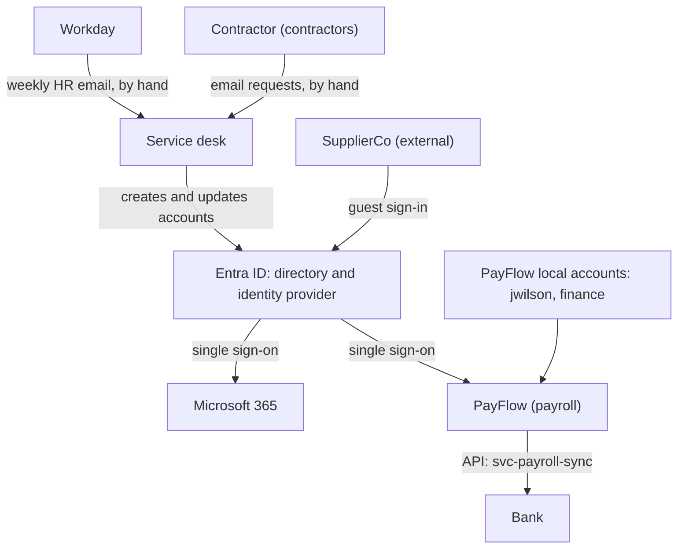

# Identity and identity systems – Lab

**Understanding XYZ's identity landscape**

**Type:** Scenario (desk exercise) · **Level:** Understand and analyse · **Time:** about 2–3 hours

---

## Lab files

These are the files I worked from. Download them to follow along or check my answers.

| File | What it contains |
| --- | --- |
| [`workday_employees.csv`](lab-data/workday_employees.csv) | 11 employees from the HR system |
| [`contractor_system.csv`](lab-data/contractor_system.csv) | 4 contractors from the contractor management system |
| [`entra_id_accounts.csv`](lab-data/entra_id_accounts.csv) | All 25 accounts in the Entra ID directory |
| [`payflow_users.csv`](lab-data/payflow_users.csv) | All 7 users of the PayFlow payroll application |
| [`data-dictionary.md`](lab-data/data-dictionary.md) | What every field means |

All data is fictional and assessed as at **15 November 2026**.

---

## Business scenario

XYZ Pty Ltd is a small company with 11 employees and 4 contractors. Its identity information sits in four systems:

| System | What it does at XYZ |
| --- | --- |
| **Workday** | HR records for employees. HR enters starters, changes and leavers here |
| **Contractor system** | Contract managers record contractors and their engagement dates |
| **Microsoft Entra ID** | The directory and identity provider. Staff sign in to Microsoft 365 and PayFlow with it. The service desk creates and updates accounts by hand, from a weekly HR email and from contractor requests sent by email |
| **PayFlow** | The payroll application. Most users sign in through Entra ID (single sign-on), but PayFlow can also hold its own local accounts. It sends a bank payment file through an API account |

The CISO asks:

> "Can we explain how identities are represented across our organisation, which systems hold identity information, and who is accountable for that information?"

**Scope:** this lab is about how identities are represented and who is accountable for them.
---

## Part A – IAM Analyst perspective

*The question this role asks: how is identity represented, and how do the systems connect?*

### Exercise A1: Identify the identities

**Task:** classify every Entra ID account and PayFlow user: human or non-human, relationship, purpose, and what it represents.

**My answer**

**Entra ID (25 accounts)**

| Account | Subject | Relationship | Purpose | What it represents |
| --- | --- | --- | --- | --- |
| `sarah.mitchell` | Human | Employee | Standard | Managing Director |
| `daniel.nguyen` | Human | Employee | Standard | IT and Security Manager |
| `james.wilson` | Human | Employee | Standard | Finance Director |
| `tom.harris` | Human | Employee | Standard | Systems Administrator, everyday account |
| `adm-tom.harris` | Human | Employee | Privileged | Tom's separate admin account |
| `ram.kumar` | Human | Employee | Standard | Finance Manager |
| `lucas.martin` | Human | Employee | Standard | Payroll Officer |
| `isla.scott` | Human | Employee | Standard | Customer Service Manager |
| `ethan.young` | Human | Employee | Standard | Customer Service Officer |
| `oscar.hall` | Human | Employee | Standard | Customer Service Officer (started 10 Nov) |
| `ravi.patel` | Human | Employee | Standard | Systems Administrator |
| `adm-ravi.patel` | Human | Employee | Privileged | Ravi's separate admin account |
| `mei.chen` | Human | Employee | Standard | Cloud Engineer |
| `mei.chen.ext` | Human | Contractor | Standard | Mei's earlier contractor account |
| `ben.foster.ext` | Human | Contractor | Standard | Network contractor (TechStaff) |
| `kai.morgan.ext` | Human | Contractor | Standard | Accounts contractor (FinTemp) |
| `jordan.price.ext` | Human | Contractor | Standard | Cloud contractor (CloudPro) |
| `j.wilson` | Unknown | Unknown | Unknown | Can't tell: no record, no owner, no description |
| `finance.shared` | Human (several) | Employees | Shared | One login used by the finance team |
| `svc-backup` | Non-human | None | Service | Nightly backup job |
| `svc-payroll-sync` | Non-human | None | Service | Sends the payroll file from PayFlow to the bank |
| `svc-quarterly-bas` | Non-human | None | Service | Quarterly BAS lodgement job |
| `breakglass-01` | Human (in an emergency) | None | Emergency | Emergency access if normal sign-in fails |
| `agent-helpdesk-assistant` | Non-human | None | AI agent | Triages password reset requests |
| Guest `j.smith` | Human | External guest | Standard | John Smith from SupplierCo |

**PayFlow (7 users)**

| PayFlow user | Signs in with | Linked Entra ID identity | What it represents |
| --- | --- | --- | --- |
| `P001` ram.kumar@xyz.com.au | Entra ID single sign-on | `ram.kumar` | Ram, pay run approver |
| `P002` lucas.martin@xyz.com.au | Entra ID single sign-on | `lucas.martin` | Lucas, payroll processor |
| `P003` james.wilson@xyz.com.au | Entra ID single sign-on | `james.wilson` | James, finance administrator |
| `P004` jwilson | PayFlow password | None | Unknown "J Wilson", pay run approver |
| `P005` finance | PayFlow password | None directly (same team as `finance.shared`) | Shared finance login, payroll processor |
| `P006` svc-payroll-sync@xyz.com.au | API client secret | `svc-payroll-sync` | The bank file export |
| `P007` kai.morgan.ext@xyz.com.au | Entra ID single sign-on | `kai.morgan.ext` | Kai, read-only |

**What I noticed**

- 25 accounts is not 25 people. XYZ's sources list 15 records, but Mei Chen appears twice (contractor, then employee), so there are 14 people. Add one external guest, one unknown account, four non-human identities, and accounts that belong to no single person (shared and emergency).
- Three people have more than one account. Tom and Ravi each have a standard and an admin account (one identity, two accounts). Mei has two identities, a contractor one and an employee one, each with its own account (one entity, two identities).
- PayFlow isn't only a consumer of Entra ID identities. Two of its seven users exist only in PayFlow.

### Exercise A2: Separate the concepts

**Task:** For one employee, one non-human identity and the external guest, separate entity, identity, identifier, account and credential.

**My answer**

| Concept | Ram Kumar (employee) | `svc-payroll-sync` (non-human) | John Smith (guest) |
| --- | --- | --- | --- |
| **Entity:** who or what exists | Ram, the person | The payroll-to-bank integration, a piece of software | John Smith, a person who works for SupplierCo |
| **Identity:** what represents it, in which context | His XYZ employee identity: Finance Manager in Finance (Workday). In PayFlow he is also a pay run approver | A service identity in Entra ID and an API user in PayFlow ("Bank file export") | A guest identity in XYZ's directory. His main identity belongs to SupplierCo |
| **Identifier:** what tells it apart | `E1020` in Workday; `ram.kumar@xyz.com.au` in Entra ID and PayFlow; `P001` inside PayFlow | `svc-payroll-sync@xyz.com.au`; `P006` inside PayFlow. No employee ID, because no person is behind it | `j.smith_supplierco.com.au#EXT#@xyz.onmicrosoft.com`, built from his SupplierCo email |
| **Account:** what it acts through | Entra ID `ram.kumar`; PayFlow `P001`, reached through single sign-on | Entra ID `svc-payroll-sync`; PayFlow `P006` | One guest account in XYZ's Entra ID |
| **Credential / authenticator:** how it proves itself | Password + authenticator app, in Entra ID. PayFlow relies on Entra ID, so he has no separate PayFlow password | A client secret: a long secret string, which works like a password for software | Signs in at SupplierCo. XYZ never sees his password; it trusts SupplierCo's sign-in |

**What I learned from this:** one entity can have several identifiers, and they're different in every system. Ram has three. The only thing joining his HR record to his directory account is `employee_id`. The guest shows that a credential doesn't have to belong to the organisation that grants access.

### Exercise A3: Map the identity systems

**Task:** Show where identity information starts, where it's stored, which system is the identity provider, which applications use it, and how information moves.

**My answer**

| Question | Answer |
| --- | --- |
| Where does identity information start? | Workday for employees, the contractor system for contractors. Non-human identities have no source: they're created straight in Entra ID |
| Where is it stored? | Entra ID holds a copy of most of it. PayFlow holds its own users, including two local accounts that exist nowhere else |
| Which system is the identity provider? | Entra ID. It checks credentials and signs people in to Microsoft 365 and PayFlow |
| Which application consumes identity information? | PayFlow, through single sign-on. It also maintains some identities itself, so it acts as a second, smaller identity store |
| How does information move? | Entirely by hand. HR and contract managers send emails, and the service desk retypes the details into Entra ID. Nothing is automatic, so nothing keeps the copies in step |

### Exercise A4: Trace one person

**Task:** Trace Ram Kumar through Workday, Entra ID and PayFlow.

**My answer**

| System | Identifier | What it holds about Ram |
| --- | --- | --- |
| Workday | `E1020` | Finance · Finance Manager · manager E1004 (James Wilson) · Active · started 14 Apr 2020 |
| Entra ID | `ram.kumar@xyz.com.au` (with `employee_id` E1020) | **Human Resources · HR Manager · manager Sarah Mitchell** · date of birth · password + authenticator app · last sign-in 14 Nov. Also listed as manager and sponsor of contractor Kai Morgan |
| PayFlow | `P001`, username `ram.kumar@xyz.com.au` | Single sign-on · pay run approver · last login 12 Nov |

- **Same identifier everywhere?** No. Workday uses `E1020`, Entra ID and PayFlow use his sign-in name, and PayFlow adds its own `P001`. The `employee_id` field in Entra ID is the only link back to HR.
- **Does the information agree?** No. Entra ID still describes Ram in his old HR job. Workday is the authoritative source for department, job title and manager, so Workday is right and Entra ID is out of date.
- **Something odd:** PayFlow gives him a Finance role (pay run approver), so PayFlow knows about his move but the directory doesn't.
- **Something else:** Entra ID holds Ram's date of birth, but the Workday export doesn't include it. I can't tell where that value came from.

---

## Part B – GRC Analyst perspective

*The question this role asks: who is accountable for each identity, and can its information be trusted?*

### Exercise B1: Ownership

**Task:** For each identity, is there an owner or accountable party, is its purpose documented, and who keeps its information correct?

**My answer**

| Group | Accounts | Owner or accountable party | Purpose documented? | Who keeps it correct |
| --- | --- | --- | --- | --- |
| Employee standard accounts | 11 | The person, linked to Workday by `employee_id`; their manager | Yes, through the Workday record | HR in Workday; the service desk copies it |
| Admin accounts | `adm-tom.harris`, `adm-ravi.patel` | The person, recorded in `owner_or_sponsor_upn` | Yes ("Admin account") | Service desk |
| Contractor accounts | 4 | Sponsor, recorded in the contractor system and in Entra ID | Yes, through the contractor record | Contract managers; the service desk copies it |
| `svc-quarterly-bas` | 1 | James Wilson | Yes | No one named |
| `breakglass-01` | 1 | Daniel Nguyen | Yes | No one named |
| `svc-payroll-sync` | 1 | Ravi Patel, **who has left** (Workday E1047, Terminated) | Yes | No one |
| `svc-backup`, `agent-helpdesk-assistant`, `finance.shared` | 3 | **None** | Yes, in the description only | No one |
| `j.wilson` | 1 | **None** | **No** | No one |
| Guest `j.smith` | 1 | **No sponsor** | **No** | No one |
| PayFlow local `jwilson` and `finance` | 2 | **Not recorded** in the PayFlow export | **No** | Unknown; whoever administers PayFlow |

**Result:** 19 of the 25 Entra ID accounts link to an owner or an authoritative record. Six don't, or their owner has left.No non-human identity has a register or a named person to keep its information correct.

### Exercise B2: Authoritative sources

**Task:** Which system should be trusted for each key attribute, where do systems disagree, and who fixes it?

**My answer**

| Attribute | Authoritative source | Copied to | Agrees? |
| --- | --- | --- | --- |
| Name | Workday (employees), contractor system (contractors) | Entra ID, PayFlow | Yes |
| Department | Workday | Entra ID | **No:** Ram (Human Resources vs Finance) |
| Job title | Workday | Entra ID | **No:** Ram (HR Manager vs Finance Manager) |
| Manager | Workday | Entra ID | **No:** Ram (Sarah Mitchell vs James Wilson); Lucas (blank vs Ram Kumar) |
| Contractor sponsor and dates | Contractor system | Entra ID (sponsor only) | Sponsors agree. Kai Morgan has no end date in the source itself |
| Date of birth | **None found** | Entra ID | Can't check: no source in the exports |
| Owner of a non-human identity | **None:** there's no register | Entra ID free-text field | Can't check |
| PayFlow role | PayFlow | -  | Not applicable |

**Who fixes a disagreement?** No one is named. HR sends a weekly email, the service desk retypes it, and nobody compares the two afterwards. The disagreements are a direct result of the manual process.

### Exercise B3: Basic governance gaps

**Task:** Find gaps in ownership, purpose, consistency, origin and personal information. Say why each matters and what I'd ask.

**My answer**

| # | Observation | Evidence | Why it matters | What I'd ask |
| --- | --- | --- | --- | --- |
| G1 | Four identities have no owner | `entra_id_accounts.csv` · `svc-backup`, `agent-helpdesk-assistant`, `finance.shared`, guest `j.smith` · `owner_or_sponsor_upn` · blank | No one answers for them, so no one checks whether they're still needed or used properly. The AI agent works close to password resets | IT: who set up each one, and who should own it? |
| G2 | A service account is owned by someone who has left | `svc-payroll-sync` · `owner_or_sponsor_upn` · `ravi.patel`; `workday_employees.csv` · E1047 · `Terminated` | It moves payroll money to the bank. Its owner is gone, and he may still know the client secret | Finance and IT: who owns the bank interface now? When was the secret last changed? |
| G3 | Directory and HR disagree | `ram.kumar` · department, job title and manager differ from Workday E1020; `lucas.martin` · `manager_upn` · blank | Anything relying on these attributes, such as approvals or group rules, uses wrong information | HR: when did Ram move? How is the service desk told about changes? |
| G4 | Identities with no known origin | Entra ID `j.wilson` (no record, created 2018) and PayFlow `P004 jwilson` (local, pay run approver). Both last active on **11 Apr 2026** | I can't say who these are. The shared name and date suggest one person, possibly an old account of James Wilson. An unknown pay run approver is a serious question | James Wilson and the PayFlow administrator: do you recognise these accounts? |
| G5 | Identities outside the directory | `payflow_users.csv` · `P004`, `P005` · `sign_in_method` · PayFlow password | They bypass Entra ID, including its MFA. The shared `finance` login means payroll actions can't be traced to a person | PayFlow administrator: why are local accounts allowed? Who uses `finance`? |
| G6 | Personal information with no evident purpose | `entra_id_accounts.csv` · `date_of_birth` · filled on all 11 employee accounts; not in the Workday export | Date of birth is personal information. If no process needs it in the directory, holding it there adds privacy risk (APP 3, APP 11) | HR and the Privacy Officer: what uses it, and where did it come from? |
| G7 | One person, two unlinked identities | Mei Chen: contractor `C2005` and employee `E1102`; Entra ID `mei.chen.ext` and `mei.chen` | Her history is split, and nothing links the two. Activity can't be traced to one person easily | IT: should these be linked, and which account does she use? |

---

## How the two perspectives connect

The same data answers two different questions. Each IAM finding is what the GRC assessment builds on.

| IAM Analyst found | GRC Analyst asked |
| --- | --- |
| What each identity is (Ex. 1) | Who is accountable for it? (Ex. 1) |
| Which systems hold identity data and how it flows (Ex. 3) | Which source should be trusted, and who fixes disagreements? (Ex. 2) |
| Ram's records disagree; PayFlow has local accounts (Ex. 4) | Which gaps matter, and why? (Ex. 3) |

---

## Summary for the CISO

**What I checked:** all 25 Entra ID accounts and all 7 PayFlow users, against Workday and the contractor system, as at 15 November 2026.

For employees and contractors, we can explain who each identity is and who is accountable, because they link back to Workday or the contractor system. For everything else, we can't map how identities are mapped.

- **6 of 25 directory accounts have no valid owner,** including a payroll-to-bank interface whose owner has left and an AI agent.
- **Two identities can't be explained at all.** `j.wilson` in Entra ID and `jwilson` in PayFlow may be the same person, and one is a pay run approver.
- **Identity data reaches the directory by hand, so it drifts.** Ram's directory record still shows his old HR job.
- **PayFlow holds two local accounts** outside the directory and its MFA, one of them shared.

**What I'd do first:**

1. Name an owner for every account without one, starting with `svc-payroll-sync` and the AI agent, and change the payroll interface secret.
2. Identify `j.wilson` and `jwilson` at first. If no one claims them, disable both.
3. Agree that Workday and the contractor system are the sources of truth, and decide who checks the directory against them until that check is automated.
4. Ravi Patel left on 31 October, but his account signed in on 3 November. That may be a security incident and shouldn't wait for the lifecycle review.

---

