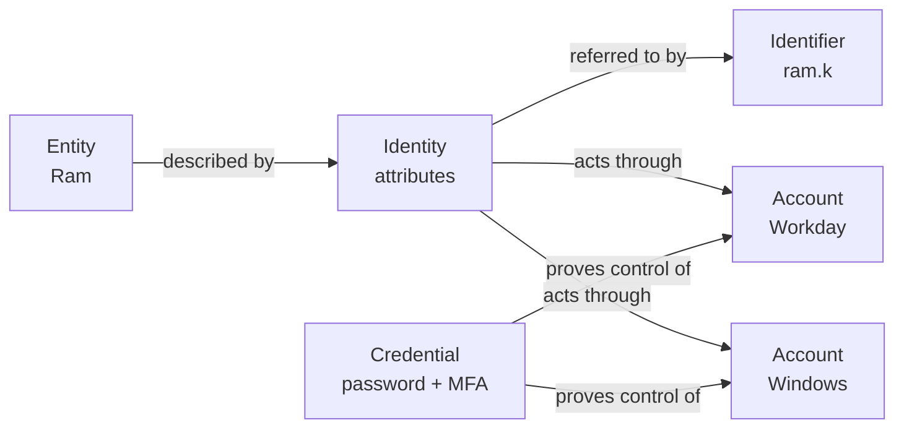

## Topic 1: Identity and Identity Systems

---

## Fundamentals

### Identity

In everyday life, identity is the collection of things that show who you are: your face, fingerprint, name, date of birth, and documents like a passport or driver licence.

Each of these is an **attribute**, a fact about you. Put enough attributes together and they answer the question "who is this?"

ISO/IEC 24760-1 puts it simply: an identity is **a set of attributes related to an entity**.

An identity doesn't need to be unique across the world. It only needs to be distinguishable in its context. My employer and my bank can each have their own version of me.

An identity describes an entity. It doesn't prove the entity is genuine. Anyone can type "Ram" and an employee ID into a form. Separate processes (identity proofing, authentication, and checking against an authoritative source) are needed to establish that the claimed identity is real.

### Digital identity

A digital identity is the same idea inside a computer system: the attributes and identifiers stored electronically so a system can recognise an entity, tell it apart from others, and link it to what it does.

The entity isn't always a person. Laptops, applications, service accounts and bots have identities too.

A digital identity involves four related concepts. Not every identity has all of them: a service account may have no password, and one identity can have several identifiers.

| Part | What it is | Example |
| --- | --- | --- |
| Attributes | Facts about the entity | Name, job title, department |
| Identifiers | A value that points to one identity in a system | Employee ID 10432, username ram.k |
| Credentials | Something used to prove you are who you claim | Password, OTP, passkey |
| Claims | A statement about the entity, made by someone | "Ram is an HR manager at company XYZ" |

---

## Purpose

The purpose of an Identity System is to provide an organisation with a coordinated and reliable way to identify, manage and track all human and non-human identities across its systems and applications. It helps organisations know who or what exists, what access they should have, and when that access needs to be modified or removed. Without it, managing thousands of identities across multiple applications becomes difficult, increasing the risk of orphan accounts, unauthorised access and poor accountability. A good identity system enables efficient onboarding and offboarding, consistent access management, auditability, and reduced manual administration.

---

## Core concepts

### Terms

| Term | Meaning | Example |
| --- | --- | --- |
| Entity | The actual person, device or thing | Ram, a laptop, a payroll app |
| Identity | The attributes describing the entity | Ram, HR Manager, HR department |
| Identifier | A value that distinguishes an identity within a system | ram.k, employee ID 10432 |
| Account | A record in one system through which the identity acts | Ram's Workday login, Ram's Windows login |
| Credential | Information or an object used to prove identity or control during authentication | Password, passkey, certificate |

One entity can have many identities (one per context). One identity can have many accounts (one per system).

The diagram shows one credential working for both accounts. That's only true when both systems trust the same identity provider, for example Workday using Entra ID for single sign-on and Windows signing in to the same directory. If an app keeps its own sign-in, Ram has a separate credential for it.

### Identity depends on context

Each organisation only needs the part of me that's relevant to it.

| Organisation | What it needs |
| --- | --- |
| Employer | Employee ID, salary, designation, department |
| Bank | Customer ID, accounts held |
| Gym | Membership number, status |
| University | Student ID, course, enrolment status |
| Government | Digital ID, verified attributes |

The gym has no reason to know my enrolment status, and the university doesn't need my gym membership.

Note: These identities can still be linked on purpose, for example through federation.

### Types of identity

Two separate questions describe an identity:

| Question | Types | Examples |
| --- | --- | --- |
| Who is it, in relation to the organisation? | Workforce | Employees, contractors |
| | Customer | Online banking customers |
| | Partner / third party | Suppliers, business partners |
| Is it a person? | Human | Ram |
| | Non-human | Servers, applications, service accounts, workloads, AI agents |

### Only collect what you need

The principle: collect and share only the attributes needed for the purpose.

For an identity system, this means storing and sharing only the attributes needed for legitimate business purposes: lifecycle management, access decisions, accountability and compliance. Each app gets only what it needs. Every extra attribute is one more thing that can leak.

The privacy laws behind this (APP 3, APP 6, GDPR) are in Governance.

---

## Components

### Identity system

The technologies, processes, policies and repositories used to create, manage, verify and retire digital identities and their attributes across their whole lifecycle.

It has 6 components:

| # | Component | The question it answers |
| --- | --- | --- |
| 1 | Identity store | Who exists? |
| 2 | Lifecycle management | When does access start, change and stop? |
| 3 | Authentication | Can you prove you control this account? |
| 4 | Authorisation | What are you allowed to do? |
| 5 | Privileged access management (PAM) | Who holds powerful access, and when? |
| 6 | Governance, monitoring and audit | Is all of this still right, and what happened? |

This six-part split is a learning model I'm using for this series, not an official standard architecture. Vendors and frameworks group these functions differently. Governance and monitoring also run across every other component the whole time, not just at the end.

Conceptually, each component takes something from another and hands something on. This shows how they relate, not a fixed order a real system must follow:

| Component | Receives | Hands on |
| --- | --- | --- |
| 1 Identity store | Identity data from the authoritative source (HR, contractor system) | A current record of who exists, with attributes |
| 2 Lifecycle management | Joiner, mover and leaver events | Accounts and access created, changed or removed in each app |
| 3 Authentication | A sign-in attempt against an account | A verified session or token |
| 4 Authorisation | The verified identity plus its roles, groups and attributes | Allow or deny for each action |
| 5 Privileged access management | Requests for powerful access | Time-limited, recorded admin access |
| 6 Governance, monitoring and audit | Logs and access data from all of the above | Alerts, review results and corrections back to 1 and 2 |

### 1. Identity store

A centralised or distributed store of digital identity records and their attributes. Other systems rely on it for identity data.

The types of store, and how they sit next to the HR system, are under Enterprise implementation.

Commonly used: Active Directory, Microsoft Entra ID, OpenLDAP. Workday and SAP SuccessFactors also hold identity records, but in workforce IAM their usual role is the authoritative HR source that feeds the store.

### 2. Lifecycle management

Identities are not permanent. They change as an individual's relationship with an organisation evolves. Therefore, organisations need a set of processes and tools to manage an identity throughout its lifecycle, from creation and modification to eventual removal. Identity Lifecycle Management ensures that identities and their associated access are created, updated and deactivated when required.

**Everyday example:** a library card. You get one when you join, your details are updated when you move house, and it's cancelled when you leave the area. If nobody cancels it, someone could still borrow books in your name.

#### Joiner, mover, leaver model (JML)

| Event | What triggers it | What should happen |
| --- | --- | --- |
| Joiner | HR records a new hire (or a contractor is added to the contractor system) | Identity created in the store; birthright access given (email, intranet, the apps everyone in that role gets) |
| Mover | HR records a change of role, department or manager | New access added **and** old access removed |
| Leaver | HR records an end date | Accounts disabled, sessions and tokens revoked, credentials invalidated; accounts deleted later under the retention rule |

### 3. Authentication

Two separate steps:

- **Identification**: who are you? You claim an identity, for example by typing a username.
- **Authentication**: are you really who you claim to be? The system checks the evidence you give it.

Strictly, authentication proves that you control the authenticator registered to the account (the password, the passkey, the security key). It doesn't prove you're the real person. An attacker with Ram's stolen password authenticates as Ram. That's why MFA matters, and why the account must have been tied to the real Ram in the first place (identity proofing).

#### Factors

| Factor | Examples | Watch out for |
| --- | --- | --- |
| Something you know | Password, PIN | Easily phished or reused. Security questions are weak because the answers are often public |
| Something you have | A registered device: phone with an authenticator app, hardware token, smart card | The factor is the registered device, not any phone. SMS codes can be intercepted or redirected to an attacker's SIM |
| Something you are | Fingerprint, face, voice | Can't be changed if leaked. Usually used on the device to unlock a passkey, not sent over the network |

**MFA** means two or more factors from **different categories**. A password plus a PIN isn't MFA, because both are something you know.

### 4. Authorisation

Authorisation decides what an authenticated identity is allowed to do with a specific resource.

**Everyday example:** a hotel key card. Checking in proves who you are (authentication). The card then opens your room, the gym and the lift to your floor, but not other guests' rooms (authorisation).

#### Authentication vs authorisation

- Authentication normally happens once at sign-in, and again when the session expires.
- Authorisation should be checked for every protected request: open a file, approve a payment, call an API.
- In practice, some systems cache decisions or put permissions inside a token. The app then trusts the token until it expires, so a removed permission can keep working for a while.
- Passing authentication says nothing about what you may do. Many breaches happen *after* a valid sign-in, because the app didn't check permissions properly. Broken Access Control is ranked first in the OWASP Top 10:2025 (A01:2025).

#### Key terms

| Term | Meaning | Example |
| --- | --- | --- |
| Permission / entitlement | One specific right in one system | "Approve invoices up to $10,000" in SAP |
| Role | A named bundle of permissions for a job | "Accounts Payable Officer" |
| Group | A set of identities given the same access | AD group "Finance-AP-Users" |
| Policy | A rule that decides access | "Contractors can't access payroll data" |

#### Common access models

| Model | How it decides | Where you see it |
| --- | --- | --- |
| Access control list (ACL) | A list on the resource says who can do what | File share and folder permissions |
| Role-based (RBAC) | Access comes from the roles you hold | Most business apps; Entra ID and Azure roles |
| Attribute-based (ABAC) | Rules check attributes of the user, resource, action and context | "Finance staff, on a managed device, during business hours" |
| Relationship-based (ReBAC) | Access follows a relationship | "You can edit a document you own or that was shared with you" |

#### Principles

- **Least privilege:** only the access needed for the job, for only as long as it's needed.
- **Segregation of duties (SoD):** no single person can complete a risky process alone (e.g. create a supplier *and* pay it). Systems enforce this with rules that block conflicting roles.

### 5. Privileged access management (PAM)

Privileged access management (PAM) controls, limits and records the accounts that can change systems, security settings or other people's access.

**Everyday example:** the master key in an apartment building. It isn't left on a hook. The building manager signs it out, uses it for one job, signs it back in, and the log shows who had it and when.

#### What counts as privileged

- Domain Admins in Active Directory; Global Administrator in Entra ID
- `root` on Linux, local administrator on Windows
- Database administrators, cloud subscription owners
- Service accounts with high rights
- Break-glass (emergency) accounts
- Anyone who can grant access to others (e.g. helpdesk staff who can reset passwords)

#### How it's done

| Technique | What it does | Example |
| --- | --- | --- |
| Separate admin accounts | Admin work done with a separate account, not the daily email-and-browsing one | ram.k for daily work, adm-ram.k for admin |
| Vaulting and rotation | Privileged passwords kept in a vault and changed automatically, often after each use | CyberArk, Delinea, BeyondTrust |
| Just-in-time (JIT) access | No standing admin rights; access requested, approved and removed automatically after a set time | Entra Privileged Identity Management (PIM) |
| Session monitoring and recording | Admin sessions go through a proxy that logs or records them | PAM session manager |
| Strong authentication for admins | Phishing-resistant MFA (FIDO2 security key, passkey, smart card) | Required for admin roles |
| Dedicated admin devices | Admin work done only from hardened, privileged access workstations | PAW |
| Break-glass accounts | One or two emergency accounts for when normal sign-in fails, closely monitored, credentials kept offline | Alert raised whenever one is used |

### 6. Governance, monitoring and audit

This component records what happened, and checks that the access that exists still matches the access that should exist.

**Everyday example:** a bank statement. You read it to check every transaction was really yours, and if one wasn't, you report it.

#### IGA vs PAM

These are two different disciplines, often with different tools:

- **Identity Governance and Administration (IGA)** covers everyone's access: lifecycle automation, access requests and approvals, access reviews, role management and SoD rules. Examples: SailPoint, Saviynt, Entra ID Governance. IGA spans components 2 and 6.
- **PAM** (component 5) focuses only on high-risk privileged access and how it's used.

#### Monitoring

- Logs are sent to a **SIEM** (e.g. Microsoft Sentinel, Splunk), which brings them together and runs detection rules.
- Identity threat detection looks for patterns like impossible travel, repeated MFA prompts (MFA fatigue), password spraying, a new Global Administrator, or a disabled account suddenly signing in.

#### Checking access is still right

- **Access reviews (certifications):** an IGA tool collects who has what, asks managers or app owners to keep or remove each item, records the decision, and triggers removal.
- **Reconciliation:** compares the accounts that exist in an app with the identities in the store. Accounts with no matching owner are flagged as orphan accounts.

---

## Technical deep dive

### Identifiers aren't as solid as they look

- Unique only within one system. Employee ID 10432 can exist at two companies.
- They can change. An email address changes when someone changes their name.
- They can be reused. Some places give an old username to a new person, who may then inherit the old person's access.
- An identifier only **points to** an identity. Knowing someone's email doesn't prove you are them.

### Credential vs authentication

These are easy to mix up.

- The **credential** is the thing you present: a password, a passkey.
- **Authentication** is the process of checking it.

Different credentials are checked in different ways. An OTP is compared with what the server expects. A passkey signs a challenge with a private key that is never sent to the server.

### Claims are only as good as whoever made them

"Ram is an HR manager" means a lot more coming from XYZ's HR system than from Ram himself. Before an application trusts a claim, it should know:

- Who issued it?
- How was it verified?
- Is it still current? Ram might have moved to Finance last week.
- Did it arrive unaltered? Usually this means a token digitally signed by an issuer the app trusts.

If the HR record is out of date, the app makes the wrong decision even though every technical check passes.

---

## How it works

The 6 components don't work in isolation. HR data feeds the store, the store drives lifecycle, lifecycle creates the accounts that get authenticated, and so on. Governance checks everything and feeds corrections back to the start. A delay at the start (like HR recording a leaver late) affects every component after it.

---

## References

- ISO/IEC 24760-1:2019 (Edition 2), *IT Security and Privacy – A framework for identity management – Part 1: Terminology and concepts*, with Amendment 1:2023. Freely available from the [ISO Publicly Available Standards](https://standards.iso.org/ittf/PubliclyAvailableStandards/) page.
- NIST SP 800-63-4, *Digital Identity Guidelines* (2025), for authenticator, credential and phishing-resistance terminology. https://pages.nist.gov/800-63-4/
- NIST SP 800-162, *Guide to Attribute Based Access Control (ABAC) Definition and Considerations* (2014, updated 2019). https://csrc.nist.gov/pubs/sp/800/162/upd2/final
- ANSI INCITS 359-2012, *Role Based Access Control*.
- IETF RFC 7643 and RFC 7644, *System for Cross-domain Identity Management (SCIM)* (2015).
- OWASP Top 10:2025, A01:2025 Broken Access Control. https://owasp.org/Top10/2025/
- Microsoft Learn, *Microsoft Entra data retention*. https://learn.microsoft.com/entra/identity/monitoring-health/reference-reports-data-retention
- Microsoft Learn, *What is Microsoft Entra Privileged Identity Management?* https://learn.microsoft.com/entra/id-governance/privileged-identity-management/pim-configure
- Microsoft Learn, *Securing privileged access*. https://learn.microsoft.com/security/privileged-access-workstations/overview
- [IDPro Body of Knowledge](https://idpro.org/body-of-knowledge/)
- [Awesome IAM Labs](https://blog.ansari.solutions/)
- Abbas Kudrati, *Identity and Access Management Exam Prep Guide* (2026)
- Privacy and framework sources are listed in governance.md.
